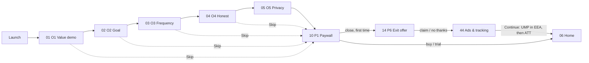
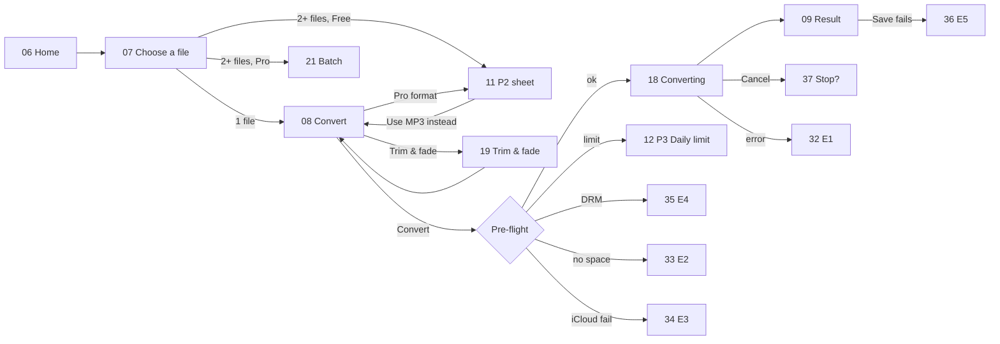
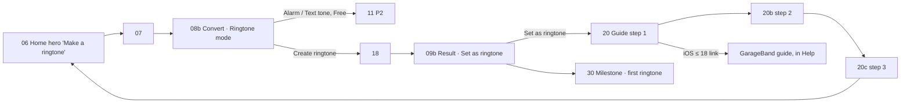
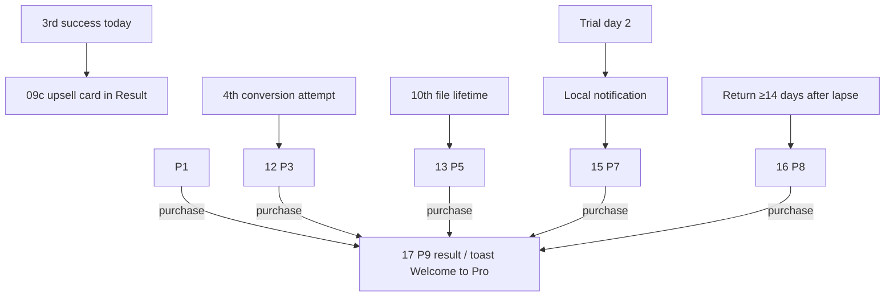
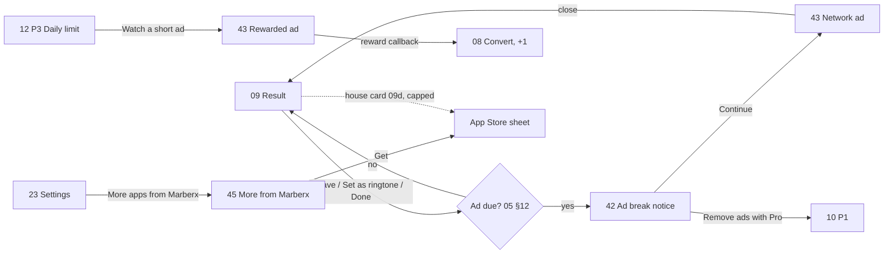
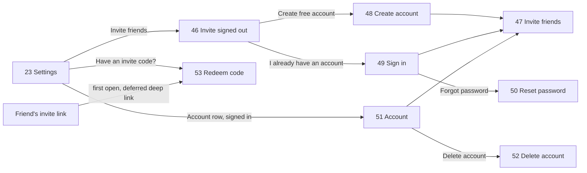

# 03 · Navigation Flows

Numbers = screens in `02_Screens_and_States.md`. Diagrams are Mermaid (render on GitHub or in Cursor preview).

## 1. First launch

## 2. Core: video or audio → file

Pre-flight order (Dart, `05` §1): readable → not DRM → downloaded (iCloud) → enough space → Pro gate (format / tone type / batch) → free limit.

## 3. Ringtone

## 4. Tabs

- **Home** (06) → tools: Video to MP3 → 07 (Videos tab) · Convert format → 07 (Audio files tab) · Trim & fade → 07 → 19 → 08 · Merge audio → 07 multi-select (Pro) → **41 Merge** → 18 → 09 · Volume boost → 07 → 19 with boost row highlighted · Batch → 07 multi-select (Pro).
- **My files** (22) → row tap plays inline · ⋯ menu: Share, Rename, Set as ringtone (→ 20), Delete (→ 39) · empty → 38.
- **Settings** (23) → 24 Preferences · 20 guide · 25 Help · Rate (Apple review sheet) · More apps (App Store product page) · Restore (→ 17b / toast) · Manage subscription (system sheet `showManageSubscriptions`).

## 5. Monetization moments

## 6. Ads and cross-promotion

## 6b. Account and referral (optional)

Transitions: 46/53 = full-screen cover (slide up); 48–52 = push. Signed-in users tapping Invite friends go straight to 47.

## 7. Deep links

`tunely://home`, `tunely://paywall?trigger=<name>`, `tunely://guide`, `tunely://files`, `tunely://invite` (46/47), universal link `https://tunely.app/i/<CODE>` → 53 with the code prefilled. The trial-reminder notification opens `tunely://paywall?trigger=trial_reminder` (shows P7). Batch-done notification opens My files.
